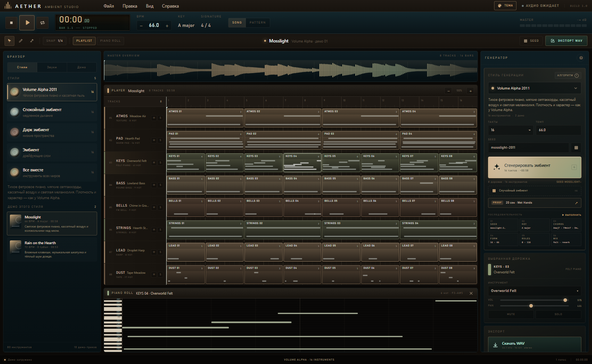
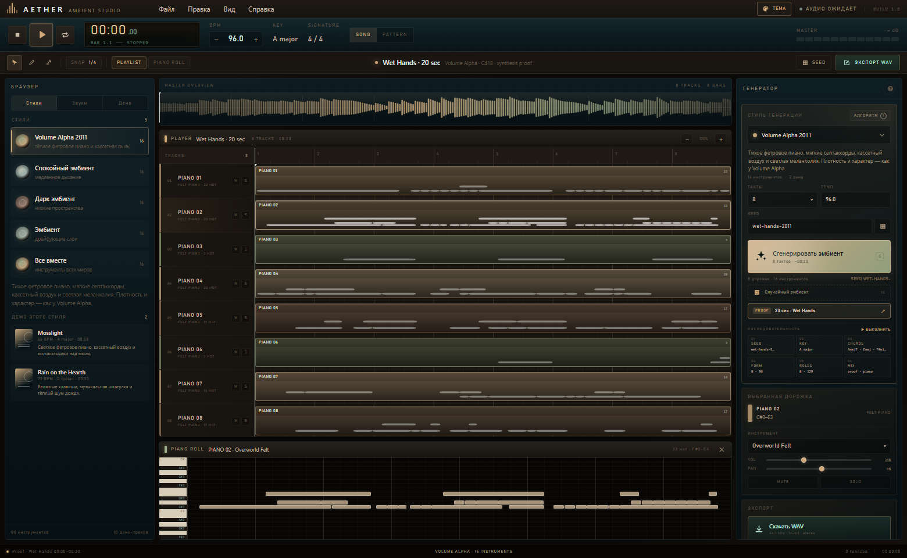

# AETHER — Ambient Studio

**AETHER** — настольная студия для генерации эмбиента в пяти характерах. Это не копия FL Studio: приложение использует знакомый язык секвенсора (дорожки, клипы, playlist, piano roll), но весь звук, интерфейс и генератор написаны с нуля.

**Volume Alpha 2011** переделан после анализа девяти референсов: фетровое пиано с hammer-транзиентом, разреженные фразы, четырёхбарная гармония, кассетная пыль и тихие пэды. Неоновую тему заменила тёплая древесно-бумажная палитра.



## Что уже внутри

- **5 стилей**, у каждого собственный набор из **16 инструментов** — всего **80**:
  - `Volume Alpha 2011` — фетровое пиано с механическим призвуком, мягкие септаккорды, кассетный воздух, редкие колокольчики;
  - `Спокойный эмбиент` — медленные пэды, вода, стекло, тихие арпеджио;
  - `Дарк эмбиент` — низкие дроны, пустые пространства, металл, шёпот;
  - `Эмбиент` — классические дрейфующие слои, ветер и поле;
  - `Все вместе` — инструменты всех направлений в свободном наборе.
- **10 демо-треков**, ровно **по 2 на каждый стиль**. Они лежат в браузере во вкладке «Демо» и в блоке «Демо этого стиля».
- Кнопка **«Сгенерировать эмбиент»** создаёт полноценную сессию: 8 дорожек, гармонию, фактуру, бас, колокола, струнные, лид и воздух. Клипы покрывают всю длину дорожки, а не только начало.
- Генератор работает детерминированно: одинаковый `seed` + стиль + темп + длина дают один и тот же трек. `Seed` можно менять вручную.
- Живой Web Audio: плей/пауза, перемотка, зацикливание, mute/solo, громкость и панорама каждой дорожки, замена инструмента, аудио-превью инструментов.
- **Piano roll** показывает ноты выбранного клипа; по клику на ноту инструмент звучит.
- **Экспорт WAV**: 44.1 kHz, 16-bit, stereo, с хвостом реверба. Рендер идёт офлайн. Ориентировочно 30–90 секунд для 16 тактов в зависимости от загрузки CPU; в это время интерфейс остаётся отзывчивым.
- Тёплая древесно-бумажная тема без неона, с адаптацией под небольшой экран: 8 дорожек, master overview, транспорт, BPM, тональность, статус голосов.

## Быстрый запуск

Готовое приложение уже собрано и проверено:

- **Один файл:** `C:\Users\Public\AetherAmbientStudio\AetherAmbientStudio.exe`.
- **Портативная папка:** `C:\Users\Public\AetherAmbientStudio\App\AetherAmbientStudio.exe`.
- **Архив портативной версии:** `dist/AetherAmbientStudio_Portable.zip`.
- **Ярлык:** `AETHER Ambient Studio.lnk` в этой папке. Если Windows покажет предупреждение, нажмите «Открыть».
- **Примеры нативного экспорта:** `C:\Users\Public\AetherAmbientStudio\Samples\Mosslight.wav` и `...\Samples\Rain on the Hearth.wav`.
- **20-секундный proof:** `...\Samples\Wet Hands 20s proof.wav` и кнопка **PROOF** в генераторе.

При первом запуске автоматически открывается демо `Mosslight` из Volume Alpha.

> **Почему exe лежит в `C:\Users\Public`?** В пути к профилю этого компьютера есть кириллическая `Я`. Python.NET (нужен для WebView2) не загружает нативные сборки из путей с кириллицей, поэтому готовый exe размещён в ASCII-пути. Запускайте exe или ярлык. Если переносите приложение на другой компьютер или распаковываете ZIP — выбирайте путь без кириллицы, например `C:\AETHER` или `C:\Users\Public\AETHER`.

### Горячие клавиши

| Клавиша | Действие |
|---|---|
| `Space` | играть / пауза |
| `S` | стоп и возврат в начало |
| `G` | сгенерировать эмбиент |
| `Shift + G` | случайный стиль + случайный эмбиент |
| `R` | новый seed |
| `T` | студия тем |
| `L` | зацикливание |
| `P` | показать/скрыть piano roll |
| `1`–`5` | выбрать стиль |
| `?` | справка |
| `Esc` | закрыть меню/окно |

## Управление

- Слева — браузер: `Стили`, `Звуки`, `Демо`. В «Звуках» 16 инструментов выбранного стиля; клик по строке проигрывает короткий фрагмент.
- В центре — playlist. Клик по линейке/пустому месту перематывает; клик по клипу выбирает дорожку и показывает ноты в piano roll.
- Справа — генератор: стиль, такты (8/16/32), BPM, seed, большая кнопка генерации и «Случайный эмбиент».
- На каждой дорожке есть `M` (mute) и `S` (solo); в инспекторе — громкость, панорама и замена инструмента.
- `Экспорт WAV` в правой панели или в верхней панели.

## Темы приложения

- Кнопка **ТЕМА** в правом верхнем углу или `Вид → Темы приложения` / `T`.
- 5 готовых тем: `Minecraft Parchment`, `Cave Lantern`, `Birch Grove`, `Nether Ember`, `Deep Aurora`.
- Редактор своей темы: имя + 6 цветов (фон, панель, текст, тихий текст, акцент, второй акцент). Остальные оттенки выводятся автоматически.
- Темы сохраняются в `%LOCALAPPDATA%\AetherAmbientStudio\settings.json` и переживают перезапуск.
- В браузере без WebView2 используется `localStorage`.

## Алгоритм случайного эмбиента

Кнопка **«АЛГОРИТМ»** в генераторе открывает трассу текущей сессии. Внутри — последовательность:

1. `seed` → FNV-1a hash → `mulberry32` PRNG;
2. профиль стиля: 8 сигнатурных инструментов, лад, BPM, эффекты;
3. тональность и аккордовая прогрессия по ступеням лада;
4. форма intro / build / body / outro;
5. восемь ролей: атмосфера, пэд, клавиши, бас, колокола, струнные, лид, пыль;
6. вероятностные генераторы нот (длительность, регистр, velocity, паузы);
7. живое планирование Web Audio и тот же граф для офлайн-экспорта;
8. кэш нот и пропуск беззвучных дорожек при рендере.

Одинаковые `seed + стиль + BPM + длина` всегда дают один и тот же проект.

Под генератором находится видимая последовательность **01 SEED → 02 KEY → 03 CHORDS → 04 FORM → 05 ROLES → 06 MIX** с текущими значениями. Кнопка **▶ ВЫПОЛНИТЬ** проходит шаги по порядку и запускает генерацию. Тот же запуск есть в окне «Алгоритм». Полное описание с формулами и псевдокодом — в **[ALGORITHM.md](ALGORITHM.md)**.

## 20-секундный proof из Volume Alpha

Кнопка **PROOF · 20 сек · Wet Hands** под генератором загружает отдельный проект `Wet Hands · 20 sec`.

- источник: `C418 — Wet Hands (Volume Alpha, 2011)`, фрагмент `00:00–00:20`;
- 129 нот получены CRNN-транскрипцией референса;
- 8 регистровых дорожек, 8 тактов × 96 BPM = ровно 20 секунд;
- звучит только синтез AETHER (фетровое пиано), оригинальный аудиофайл не встроен;
- можно слушать, менять громкость/панораму и экспортировать WAV.

Проверка сходства с оригиналом: **chroma cosine 0.928**, **DTW similarity 0.866**, тональность A major, 129 нот. Готовый файл: `C:\Users\Public\AetherAmbientStudio\Samples\Wet Hands 20s proof.wav`.



## Оптимизация

- плоский кэш нот вместо повторного `projectNotes()` в UI;
- при экспорте дорожки с mute/solo не планируются в аудиографе;
- обновление meter/voice count только во время воспроизведения;
- debounce resize и отрисовки overview;
- очистка старых графов, preview-источников и air/reverb-нод;
- офлайн-рендер 32 кГц → 44.1 кГц с лёгким overlay без blur и animations;
- генерация сессии — один синхронный проход без сетевых запросов.
- бенчмарк: **≈3,3 мс** на чистую генерацию проекта и **≈54 мс** на полную UI-генерацию (200/20 прогонов, 0 ошибок).

## Как это устроено

- **UI**: HTML/CSS/JS, без фреймворков и внешних шрифтов.
- **Оболочка**: Python + `pywebview` (WebView2/EdgeChromium), один нативный `.exe`.
- **Генератор**: собственный детерминированный композитор (`ui/js/composer.js`): PRNG, лады, аккордовые прогрессии, роли дорожек, мотивы, секционная динамика.
- **Темы**: `ui/js/themes.js` — палитры, производные CSS-переменные, сохранение через нативный bridge.
- **Синтез**: Web Audio API (`ui/js/audio.js`), wavetable/FM/шумовые движки, общий алгоритмический реверб, дилей, master EQ/компрессор.
- **Экспорт**: `OfflineAudioContext` → нормализация → 44.1 kHz WAV; запись файла через нативный диалог сохранения.
- **Проверка**: интерфейсные и структурные тесты Playwright + стресс-генерация.

## Сборка

Требуется Python 3.11+ (проверено на 3.15), Windows 10/11 с WebView2 Runtime.

```powershell
python -m pip install -r requirements.txt
python -m PyInstaller --clean --noconfirm AetherAmbientStudio.spec
```

Иконка лежит в `assets/aether.ico`, UI — в `ui/`.

## Тесты

Пока приложение запущено в режиме сервера:

```powershell
python app.py --serve --port 8765
python tests/test_suite.py
python tests/adversarial.py
```

`test_suite.py` проверяет 5 стилей, 80 инструментов, 10 демо, 15 матриц генерации, 40 стресс-проектов, play/pause/loop, дорожки, BPM, горячие клавиши, адаптивность и отсутствие ошибок консоли. Итоговый отчёт: `tests/TEST_REPORT.md`, состав демо: `tests/demo_manifest.json`.

## Структура

```
AmbientForge/
├─ app.py                     # окно, локальный сервер, мост сохранения WAV
├─ AetherAmbientStudio.spec   # сборка .exe
├─ ui/
│  ├─ index.html
│  ├─ css/app.css
│  └─ js/{instruments,composer,audio,themes,proof_cover,app}.js
├─ ALGORITHM.md               # точная последовательность генерации
├─ assets/aether.ico
├─ tests/                     # Playwright-тесты, отчёт и скриншоты
├─ dist/AetherAmbientStudio/  # портативная папка
├─ dist/AetherAmbientStudio_Portable.zip
└─ AETHER Ambient Studio.lnk  # ярлык готового приложения
```

Готовые exe и портативная папка также лежат в `C:\Users\Public\AetherAmbientStudio\` — это обход ограничения Python.NET на кириллицу в пути.
